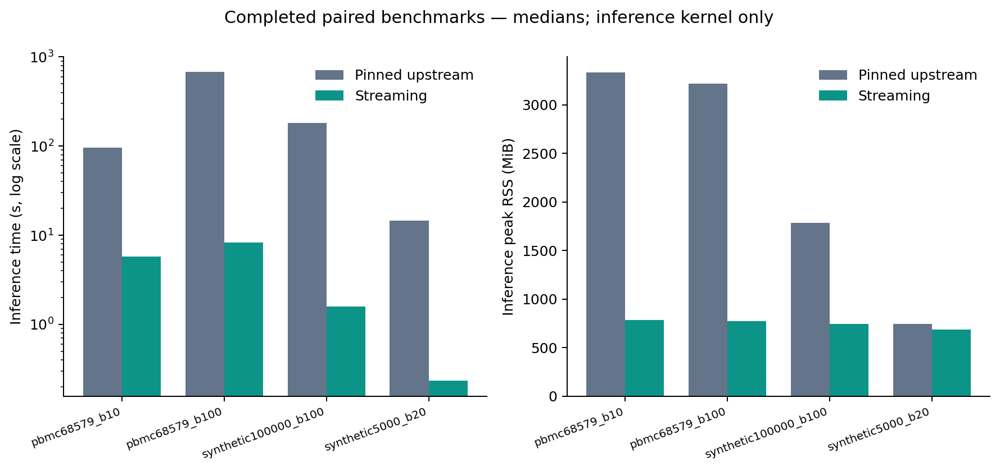

# 实验结果：保持 CellChat 定义的大规模低内存推断

本报告仅汇总保存的执行记录。推断核时间不包含导入、数据准备、差异基因筛选、绘图或下游系统分析。

基线：GitHub `986bf7ef909f1e15059aad8a9a9ee31ac675ffc3`；开发版：`1.1.0+streaming.20261020`。

## 回归测试

共 303 项：失败 0，错误 0，跳过 0。
证据：[JUnit](validation/combined_regression.xml)、[执行前后源码及测试指纹](validation/regression_provenance.json)。

## 七个公开教程

完整七本对照通过：**True**。
完整 notebook 墙钟时间含导入、绘图、审计导出和未优化的网络分析。
群体推断列另列记录器捕获的 compute_communication_probability 调用耗时总和，单位秒。

| 教程 | 原版执行 | 开发版执行 | 原版总秒 | 开发版总秒 | 群体推断秒 原/新 | 数值对照 |
|---|---|---|---:|---:|---:|---|
| 01_human_skin | passed | passed | 298.95 | 106.91 | 182.60 / 3.79 | 通过 |
| 02_nl_ls | passed | passed | 423.36 | 153.09 | 280.80 / 3.36 | 通过 |
| 03_embryonic | passed | passed | 585.48 | 110.31 | 492.21 / 7.58 | 通过 |
| 04_visium | passed | passed | 68.64 | 55.03 | 11.22 / 1.67 | 通过 |
| 05_multi_spatial | passed | passed | 468.90 | 415.22 | 11.08 / 7.83 | 通过 |
| 06_multiomics | passed | passed | 42.18 | 41.52 | 0.84 / 0.20 | 通过 |
| 07_psoriasis | passed | passed | 118.83 | 122.07 | 不适用（spot 流程） | 通过 |

概率报告最大误差；P 值要求逐项精确相等，显著性使用原来的严格 `< 0.05`。
比较导出的 LR 推断网络及 count/weight 聚合结果；路径分析等原始代码单元完整执行。
保存图文件比较记录；随机布局的像素位置不作为核心数值一致性的判据。
原公开 notebook 与 GitHub 源码代码单元一致。Visium 手算断言的一个阈值边界修复对两引擎同样应用，
详见 [修订记录](validation/tutorial_compatibility_patches.json)。

每版保存 148 张图，其中 147 张文件 SHA-256 相同。
文件不同：`02_nl_ls/tutorial/figures_comparison/cmp_13_bubble_comparison.png`。
唯一不同气泡图的列顺序及标签对应关系见 [图像差异核查](validation/figure_difference_notes.md)。

### 本次运行保存对象的补充对照

四组保存对象补充检查通过：**True**。
从本次 notebook 新生成的 pickle 中，分别用对应版本导出网络、路径网络及可用的 spot 网络。
比较包括名称、数值、中心性等已保存字段；稀疏矩阵按原生 data/indices/indptr 比较，不展开为密集矩阵。

| 教程 | 比较数组数 | 逐元素相等数组数 | 最大绝对误差 | 结果 |
|---|---:|---:|---:|---|
| 01_human_skin | 3033 | 3033 | 0 | 通过 |
| 02_nl_ls | 10380 | 10380 | 0 | 通过 |
| 03_embryonic | 14268 | 14268 | 0 | 通过 |
| 07_psoriasis | 20497 | 20186 | 1.55e-14 | 通过 |

非精确相等数组共 311 项，范围为 07_psoriasis: pathway_network/centrality，字段为 authority, eigen, hub。
这些差异均通过事先设定的浮点检查（绝对、相对容差各 1e-12），没有为通过实验放宽门槛。
每个字段的误差见 [差异附表](validation/tutorial_tolerance_differences.md)。

这些数组含稀疏索引等结构数据，数量不等于 LR 对数。P 值与整数结构要求精确一致。
Visium、多空间样本、多组学三本原教程默认不保存对象，因此没有这项 pickle 补充检查；
它们的 LR/聚合数组、完整代码执行和图文件证据单独保留，不冒称导出了所有路径数组。
[补充审计](validation/tutorial_saved_object_comparison.json)。

## 推断核性能

时间为已完成独立进程重复的中位数。`倍数 = 原版核时间 / 新版核时间`。
RSS 是推断阶段采样峰值，含该进程已加载的 Python 依赖和输入；不是只计算新分配数组。

推断内存每 20 ms 采样，整个进程由外部每 100 ms 采样；后者可能漏掉短暂峰值，因此两列不是同一采样序列的包含关系。

| 实验目录 | 数据 | 完成重复 原/新 | 原版核秒 | 新版核秒 | 倍数 | 原版 RSS MiB | 新版 RSS MiB | 数值对照 |
|---|---|---:|---:|---:|---:|---:|---:|---|
| pbmc68579_b10 | pbmc68k | 1/1 | 95.59 | 5.76 | 16.60 | 3,330.59 | 786.90 | 通过 |
| pbmc68579_b100 | pbmc68k | 1/1 | 678.77 | 8.26 | 82.18 | 3,215.72 | 774.30 | 通过 |
| synthetic1000000_b100 | synthetic | 0/1 | 未完成 | 29.90 | 未完成 | 未完成 | 1,252.88 | 原版受资源限额，无配对 |
| synthetic100000_b100 | synthetic | 3/3 | 180.54 | 1.57 | 114.67 | 1,783.86 | 742.65 | 通过 |
| synthetic5000_b20 | synthetic | 3/3 | 14.65 | 0.23 | 62.94 | 743.34 | 687.91 | 通过 |

各目录保留每个进程的命令、线程数、核时间、整个进程时间、内存、输出数组和比较。
最终兼容性修补后，开发版进程已重新执行；原版源码未变，保留本次此前完成的原版进程作对照。
被替代的开发版记录保存在对应目录的 history，summary 的 refresh_history 记录更新原因与原版文件校验。
只有一次配对的结果是本机的一次观测，不能视作多次重复的稳定估计或跨硬件保证。
第一次数值调用可能包含 JIT 初始化或缓存读取。不是每次均重新编译；不能用该结果宣称无缓存冷启动性能。
若原版因时间或内存上限退出，只报告该限制和新引擎完成结果，不虚构配对加速倍数或结果一致性。

## 完整基准进程

包括 Python 导入、此基准的数据加载/生成与对象准备、推断及结果保存；不含独立的数据下载/预处理，
也不等于包含候选筛选、下游分析和绘图的完整生物学工作流。数值为已完成重复的中位数。

| 实验目录 | 原版进程秒 | 新版进程秒 | 原版进程峰值 RSS MiB | 新版进程峰值 RSS MiB |
|---|---:|---:|---:|---:|
| pbmc68579_b10 | 124.61 | 29.73 | 3,297.76 | 789.43 |
| pbmc68579_b100 | 710.25 | 32.31 | 3,220.00 | 779.23 |
| synthetic1000000_b100 | 未完成 | 60.72 | 未完成 | 1,543.16 |
| synthetic100000_b100 | 204.30 | 24.52 | 1,787.89 | 765.46 |
| synthetic5000_b20 | 39.62 | 23.23 | 747.60 | 697.18 |

未完成记录：

- `synthetic1000000_b100` / upstream / repeat=0: `private_memory_budget_exceeded`，进程运行 58.94 秒；限额 {'timeout_seconds': 900.0, 'max_rss_gb': 4.0, 'max_private_gb': 4.0}。未完成配对，不计算加速倍数。

## 数据及边界

- 真实 PBMC 数据来自 10x Genomics，下载 URL、文件大小及 SHA256 在 `data/pbmc68k_download_manifest.json`。
- 68,579 个细胞均保留；原始表达含 32,738 个基因。归一化 library size 来自全基因计数，随后保留信号基因。
- 官方旧分析只提供部分细胞标签。完整数据采用固定参数的 SVD/KMeans 计算分组；这是性能实验分组，不声称是经验证的细胞类型注释。
- 性能实验固定相同候选 LR，未将候选筛选或 DE 纳入推断核时间；全部教程则按原工作流执行。
- 合成 100k/1m 等规模为独立生成的计数，明确不是百万细胞真实图谱验证。
- 合成十万/百万实验固定 256 个输入基因、10 个细胞群、100 对 LR、100 次置换；当前候选依赖闭包含 59 个统计基因。这不能代表任意群数或全部 LR 的百万细胞负载。
- 本机物理内存约 15.71 GiB，其他程序占用较多。大型任务串行运行并监控 RSS/private memory；未测量换页 I/O，内存压力和后台活动可能影响墙钟时间。
- 本次优化细胞群层面推断，不宣称优化 spot 层面推断、全部预处理或下游中心性算法。
- 性能基线是固定的 CellChatPy GitHub 发布源码；本次没有测量 R CellChat 或其他 Python 实现，不能据此宣称超越这些软件。
- 软件和统计定义一致性不是生物学真值验证，也不是方法首创性证明。

设计说明见 [METHOD.md](METHOD.md)。审查见 `validation/code_review.md` 和 `validation/final_independent_review.md`。

## 消融实验

另有小规模、单进程预热后的消融，用于定位优化贡献；不能与上表的独立进程计时混用。
5,000 细胞、256 输入基因、100 对 LR、20 次置换，每个变体三次计时。

| 变体 | 中位秒 | 相对完整引擎耗时 | 统计基因数 | 概率及 P 值精确一致 |
|---|---:|---:|---:|---|
| 完整引擎 | 0.2272 | 1.00 | 59 | 是 |
| 关闭静态裁剪 | 0.2031 | 0.89 | 256 | 是 |
| 关闭稀疏顺序统计复用 | 1.4883 | 6.55 | 59 | 是 |

本例支持复用稀疏顺序统计的时间收益。静态裁剪减少了统计基因数，
但关闭裁剪反而略快，因此本实验不能支持“裁剪普遍提速”的结论。
短任务计时、执行开销和机器后台负载都可能影响此小消融；最终重跑时未同时执行教程。
[原始消融记录](validation/ablation.json)。

